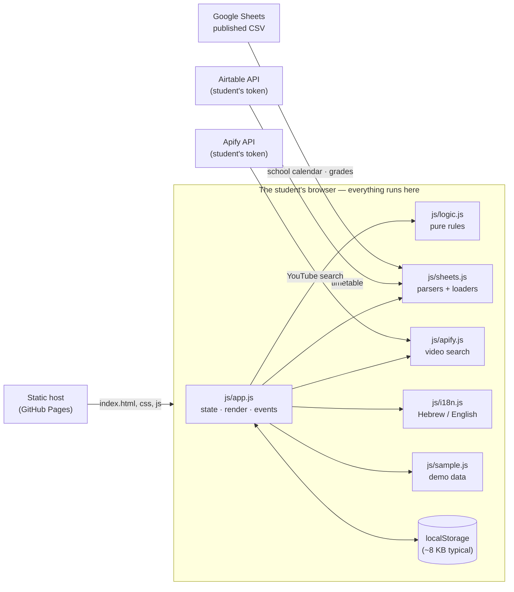

# Architecture — StudyPlanner

How the dashboard is built and where each piece runs. [`SPEC.md`](SPEC.md) says **what** the product does;
this file says **how** and **where**. [`Practice.md`](Practice.md) says how we change it. If a structural decision is not
here or in the SPEC decision log, it was not made — it just happened.

*Last checked against the code: 2026-11-02 (`master`).*

## 1. Design — what, for whom, how many, how fast

| Question | Answer |
|---|---|
| **What** | A dark-mode, Hebrew/English (RTL/LTR) dashboard: next-test countdown, today's timetable, "Today's Mission", grades, a tests list and a study-videos screen. Details: SPEC §3–§4. |
| **For whom** | One student per browser, 12+ (SPEC §2). No accounts, no teacher or parent view in v1. |
| **How many** | One user per device, so there is no concurrency to design for. Data is small: the school calendar is ~65 tests, a timetable ~40 lessons, grades in the dozens. The whole calendar cache is 7 KB. |
| **How fast** | Budget (SPEC §11): first paint < 2 s and interactive < 3 s on a mid-range phone over 4G. Measured numbers are in §5 — on a laptop, **not yet on a phone**. |
| **Offline** | Last synced data stays on screen when a source fails (per-source cache). There is no service worker yet, so the page itself needs a network the first time. |

## 2. System context



There is **no backend of ours** (SPEC decision D2). Every network call goes from the student's browser straight to a
third party. That is why the project needs no server, no database and no secrets of its own.

## 3. Modules

Scripts are plain classic scripts loaded in this order by `index.html`; each one attaches to the global `window.SP`.
No build step, no bundler, no package manager (decision D26).

| File | Responsibility | Touches the DOM / network? | Covered by |
|---|---|---|---|
| `js/logic.js` | Rules from SPEC §9: readiness, countdown, 7-day notice, clusters, grade average and trend, Today's Mission ranking, streak, tests-list filters | No — pure functions | `tests/` |
| `js/sheets.js` | CSV parsing; the school-calendar, grades and timetable parsers; subject/exam-block matching; loaders for Google Sheets and Airtable | Network only in the `load…` / `fetch…` functions; parsers are pure | `tests/` |
| `js/apify.js` | Search query, result normalisation, number/duration formatting for the videos screen | Network only in one function | `tests/` |
| `js/sample.js` | Demo data built relative to "today" | No | `tests/` |
| `js/i18n.js` | All UI strings (Hebrew + English), plural and duration helpers | No | `tests/` |
| `js/app.js` | State, merging of sources, rendering of every screen and dialog, event handling, sync timers | **Yes — the only module that does** | Manual + the phone-layout test |
| `css/styles.css` | Design tokens and styles (SPEC §6); logical properties so RTL flips automatically | — | Contrast + layout tests |

**Rule of thumb:** a new rule goes in `logic.js` or `sheets.js` with a test; `app.js` only wires data to the screen.

## 4. Data flow and state

```
 source (CSV / Airtable) ──fetch──▶ raw rows ──▶ localStorage (cache)
                                         │
                       parseSource() ◀───┘                      every 15 min, and on "Refresh"
                            │
        merge with hand-entered data (grades, lessons, tasks, local tests)  →  data()  (memoised)
                            │
                 render()  every 30 s and after each action
```

- Each source (calendar, grades, Airtable timetable) is fetched and cached **independently**; one failing source never hides
  the others (SPEC §9.7).
- Hand-entered data (grades without weight, lessons, own tasks, local tests) is merged in `data()` and never written to a sheet.
- The exam calendar is filtered to the student's subjects and exam block before it reaches the screens (decision D24).

**What is stored on the device** (`localStorage`, all keys prefixed `sp.`; every access is wrapped in try/catch because
storage can be blocked):

| Keys | Content | Sensitive? |
|---|---|---|
| `calendar`, `gradesSrc`, `airtableSrc` | Source links and chosen tab. **`airtableSrc` also holds the student's Airtable token.** | **Yes (token)** |
| `calendarRows`, `gradesRows`, `airtableRows`, `lastSync` | Last successful download of each source | Grades are personal |
| `manualGrades`, `manualLessons`, `manualTasks`, `localExams` | Hand-entered data | Personal |
| `sessions`, `done`, `mission`, `confidence` | Study log, ticked tasks, today's chosen tasks | Personal |
| `calFilter`, `lang` | Preferences | No |
| `apifyToken`, `apifyVideos` | The student's Apify token and the last 12 searches | **Yes (token)** |

## 5. Place — where it runs and what it needs

| Piece | Runs where | Needs |
|---|---|---|
| Static files (`index.html`, `css/`, `js/`) | Served by a static host (currently GitHub Pages); executed in the student's browser | Any modern browser; **168 KB uncompressed** for HTML + CSS + JS, plus the Heebo font from Google Fonts |
| All application logic | The student's browser, single thread | See measurements below |
| School calendar, grades | Google Sheets "published to the web" CSV, read cross-origin | The sheet must be published or shared by link — **anyone with the link can read it** |
| Timetable | Airtable API, read with the student's personal access token | The token (kept on the device) |
| Study videos | Apify API running a public YouTube-scraper actor with the student's token | The token; a run waits up to 180 s (`timeout` in `js/apify.js`) |
| Tests and checks | A headless browser (see [`tests/README.md`](tests/README.md)) | Chrome or Edge locally; the GitHub runner's Chrome in CI |

**Measured** on the development laptop against the real school calendar (65 tests), 2026-11-02 — these are *not* phone numbers:

| Measure | Result | Budget / limit |
|---|---|---|
| `DOMContentLoaded` (local server) | 459 ms | SPEC: interactive < 3 s on a phone — **phone not measured** |
| One full `render()` | 5.3 ms | runs every 30 s |
| Parse the calendar (88 rows) | 0.7 ms | runs every 15 min |
| `readiness()` for all 65 tests | 8.1 ms | — |
| JS heap | 4.2 MB | — |
| `localStorage` used with the calendar loaded | 8.4 KB | **5 MiB per origin** — about 600× headroom |

**Limits of what we depend on** (checked against each vendor's documentation on 2026-11-02):

| Dependency | Limit | What we do about it |
|---|---|---|
| Browser `localStorage` | 5 MiB per origin; `QuotaExceededError` when full ([MDN](https://developer.mozilla.org/en-US/docs/Web/API/Storage_API/Storage_quotas_and_eviction_criteria)) | Writes are wrapped in try/catch; the videos cache is capped at 12 searches |
| Airtable API | 5 requests/s per base, 50 requests/s per token; a `429` means wait 30 s ([Airtable](https://airtable.com/developers/web/api/rate-limits)) | One paged read (100 records per page) every 15 min — far below the limit. **No `429` handling yet** (see issue list) |
| Apify API | 60 requests/s per resource, 250 000/min global; sync endpoints wait up to 300 s ([Apify](https://docs.apify.com/api/v2)) | One request per search; we time out at 180 s. Runs consume the student's own Apify credit |
| Google Sheets (published CSV) | No published quota for the CSV endpoint; the SPEC §10.1 quotas apply to the Sheets *API*, which we do not use yet | 15-minute sync; cached data shown on failure |

**Failure behaviour:** a failed fetch sets a per-source error flag and keeps the cached data on screen; the header shows a
warning. Storage that is blocked or full degrades to in-memory state for the session.

## 6. Security and privacy boundaries

- **No data leaves the device** except requests to the three sources above, and only the student's own tokens/links are sent.
- **Tokens live in `localStorage`**, so any script injection on the page could read them. Mitigations in place: all
  dynamic text goes through `esc()`, and links from third-party data are kept only if they are `https://` (`httpsUrl` in
  `js/apify.js`). There is **no Content-Security-Policy yet** (open issue).
- Grades pulled from a public sheet are readable by anyone with that link — SPEC §11 says use test data until Google
  sign-in exists (decision D19).
- Personal files (for example a real timetable with teacher names) never go into the repository (`Practice.md` §6).

## 7. Architecture decisions

The full log lives in SPEC §13; these are the ones that shape the structure.

| ID | Decision | Why | Consequence |
|---|---|---|---|
| D2 | No backend in v1 | Avoids accounts, hosting and minors' data duties | No push when the app is closed; progress is per device |
| D17 | Phone first | Students mostly use phones | One layout; the header scrolls sideways on phones; the phone-layout test guards it |
| D19 | Google access is read-only | Smallest permission | Sign-in is not built yet, so sheets are read through public links |
| **D26** | **Plain HTML/CSS/JS with no build step** (replaces the React/Vite/Tailwind stack in SPEC §10) | Node was not installed on the development machine; the app is small; a static folder is deployable anywhere | Fewer tools to break. Costs: no type checking, no component model, `app.js` is 1 400 lines. **Revisit** if `app.js` passes ~2 000 lines or a second developer joins |
| **D27** | **Tests run in a headless browser, not Node** | The code reads `window`/`document`, and the contrast and phone-layout checks need a real browser engine | One harness (`tests/`) for the laptop, the git hook and CI; Chrome or Edge is required |
| **D28** | **`master` accepts changes only through a pull request with green tests** | A push to `master` is what end users get | Direct pushes to `master` stop; see `Practice.md` |

## 8. Known gaps

Each of these is tracked as a GitHub issue (label `tech-debt` or `enhancement`).

- `sheets.js` still contains the removed "personal sheet" path: `normalize` (used only by tests) and `loadSheet` with its
  `TABS`/`hasHeaders` helpers (used by nothing).
- No `429` back-off for Airtable; no timeout for Google fetches.
- No Content-Security-Policy; tokens in `localStorage`.
- No service worker, so no offline start (SPEC §11).
- Performance has not been measured on a phone (no Lighthouse run).
- `app.js` is one 1 400-line file; screens could be split once it grows.
- SPEC §10 still lists the old stack — see the note added there with D26.

## 9. Keeping this file true

Change the structure (a new module, a new external service, a new stored key, a new limit) → update this file **in the same pull
request**. The pull-request template asks for it.
